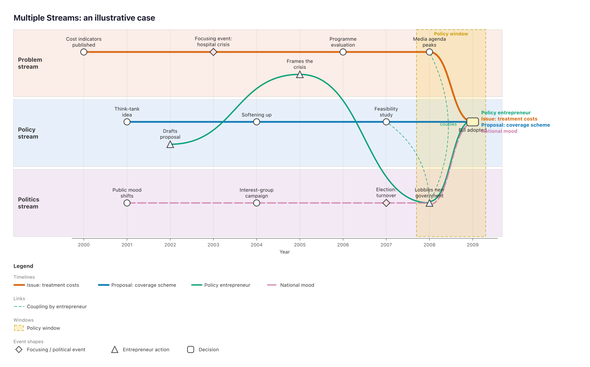

# maketimeliner

Non-linear, multi-stream timelines in R: several timelines (actors, issues,
proposals) move along a time axis while **crossing between parallel streams**,
as in Kingdon's Multiple Streams Framework. Output is a static **SVG** and a
self-contained **interactive HTML** file (no CDN, works offline). A **Shiny app**
edits every input table.



## Install

```r
devtools::install("path/to/00_utilities_R/maketimeliner")
```

## Data model (matxingraphout-style)

| Table (CSV suffix) | Role | Key columns |
|---|---|---|
| `_node_props.csv` | events | **id, time, stream**, label, slot, shape, colour, alpha, stroke, stroke_width, linetype, fontcolour, fontsize, width, height, label_position, **image** (picture URL), description |
| `_adj.csv` | links between events | matrix; cell = **timeline code(s)**, e.g. `1` or `1;3` |
| `_edge_props.csv` | one row per timeline | **weight** (= code), label, colour, alpha, width, linetype, description |
| `_edge_labels.csv` | text on links | matrix |
| `_streams.csv` | lanes (any number) | id, label, order, colour, alpha, stroke, stroke_width, linetype, height, fontcolour, description |
| `_windows.csv` | periods (policy windows) | start, end, label, colour, alpha, stroke, stroke_width, linetype, streams, description |
| `_overlay.csv` / `_overlay_edge_props.csv` / `_overlay_edge_labels.csv` | annotation arcs (e.g. coupling) | as above |
| `_phases.csv` | ordinal time axis | phase, order, label |
| `_legend_colours.csv`, `_legend_shapes.csv` | legend | colour/shape, label |
| `_settings.csv` | all options | Setting, Value (see `timeline_defaults()`) |

`time` can be numeric (years), dates (`YYYY-MM-DD`, `YYYY-MM`) or phase names.

## Use

```r
library(maketimeliner)

spec <- read_timeline_csvs("my_case_csvs/")         # or kingdon_example()
render_timeline(spec, "case.html", "case.svg", curve = "sigmoid")

# matxingraphout-style one call
timeline_to_outputs(adj, nodes, streams, edge_props, windows = windows,
                    title = "My case", html_file = "case.html")

write_timeline_csvs(spec, "out_dir", prefix = "case")  # round-trip
run_app()                                             # Shiny editor
```

## Interactive HTML

Hover an event to see its details and its **picture** (the `image` URL column; http(s), relative paths or `data:image/…`; size via `tooltip_image_width`). Hover a timeline to highlight it; click to pin it (you can pin several); toggle
timelines on and off; dim streams; search events; click an event, timeline,
stream or window to open the details panel (sequence, stream crossings, events
inside a window); zoom with the scroll wheel; drag to pan; download the SVG.
